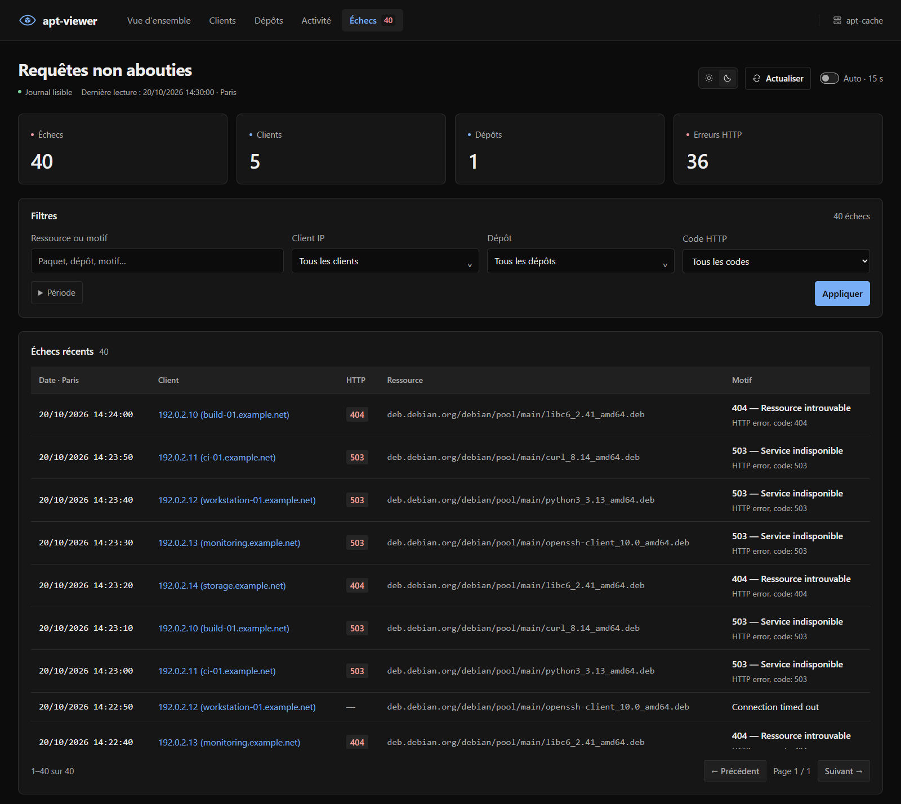

# apt-viewer

<p align="center">
  <a href="#démarrage">Démarrage</a> &nbsp;·&nbsp;
  <a href="#configuration">Configuration</a> &nbsp;·&nbsp;
  <a href="docs/deployment.md">Déploiement</a> &nbsp;·&nbsp;
  <a href="docs/reference.md">Référence</a>
</p>

**apt-viewer** affiche l’activité d’**apt-cacher-ng** : clients, dépôts, volumes transférés et erreurs HTTP.


<details>
<summary>Voir la page des échecs</summary>



</details>

## Dans l’interface

- **Vue d’ensemble** — volumes et répartition de l’activité par client et destination.
- **Clients et dépôts** — volumes entrants et sortants, noms DNS et dernière activité.
- **Activité** — transferts et ressources, avec recherche et filtres.
- **Échecs** — codes HTTP, motifs et ressources concernées.

Recherche par IP ou nom DNS, filtres par période, thèmes clair et sombre, actualisation automatique toutes les 15 secondes.

## Démarrage

**Node.js 24 et npm.**

```sh
git clone https://github.com/Sorway/apt-viewer.git
cd apt-viewer
npm ci
npm run demo
```

Ouvrir **[localhost:3000](http://127.0.0.1:3000)**. La démonstration utilise les journaux fournis dans [`sample/`](sample/).

### Utiliser ses journaux

Arrêter la démonstration, puis créer le fichier de configuration :

```sh
cp .env.example .env
```

Sous PowerShell : `Copy-Item .env.example .env`.

Renseigner le chemin du journal dans `.env` :

```dotenv
LOG_PATH=/var/log/apt-cacher-ng/apt-cacher.log
```

Le compte qui lance l’application doit pouvoir lire ce fichier.

```sh
npm start
```

## Configuration

| Variable | Par défaut |
| :--- | :--- |
| `HOST` | `127.0.0.1` |
| `PORT` | `3000` |
| `LOG_PATH` | `/var/log/apt-cacher-ng/apt-cacher.log` |

L’application lit directement le journal et conserve les données en mémoire. Aucune base de données à configurer.

Les limites de lecture, le rafraîchissement et les autres options sont détaillés dans la [référence](docs/reference.md#configuration).

## Déploiement

Le guide [**Debian / Ubuntu**](docs/deployment.md) couvre l’installation, les permissions du journal, systemd et Nginx avec TLS et authentification.

## API

| Route | Contenu |
| :--- | :--- |
| `GET /api/dashboard` | Statistiques et transferts paginés |
| `GET /api/failures` | Échecs et codes HTTP |
| `GET /api/client-names` | Noms DNS des clients |
| `GET /healthz` | État de lecture du journal |

[Filtres, exemples et format des journaux →](docs/reference.md)

## Licence

[MIT](LICENSE).
