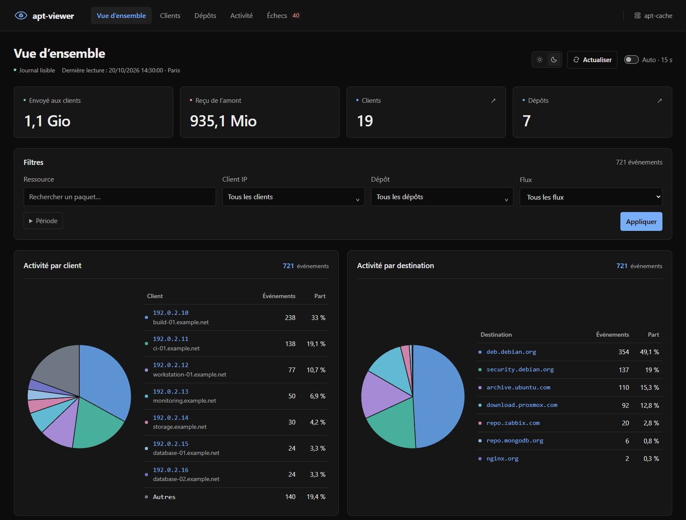

# apt-viewer

Interface web pour consulter le journal d’apt-cacher-ng : transferts, clients, dépôts et erreurs HTTP.



## Installation

Sur le serveur apt-cacher-ng, avec Debian ou Ubuntu, systemd et curl :

```sh
curl -fL https://github.com/Sorway/apt-viewer/releases/latest/download/install.sh -o install.sh
sudo bash install.sh
```

Le script installe Node.js 24 et l’application dans `/opt/apt-viewer`, puis démarre le service `apt-viewer`. La configuration est enregistrée dans `/etc/apt-viewer.env`.

L’interface écoute sur [127.0.0.1:3000](http://127.0.0.1:3000). Depuis un autre poste, ouvrir un tunnel SSH :

```sh
ssh -L 3000:127.0.0.1:3000 utilisateur@serveur
```

Pour changer le chemin du journal ou configurer Nginx, voir le [guide de déploiement](docs/deployment.md).

## Mise à jour

```sh
curl -fsSL https://github.com/Sorway/apt-viewer/releases/latest/download/update.sh | sudo bash -s
```

La commande affiche la version installée et la version cible. Si elles sont identiques, elle s’arrête. Avant l’installation, elle vérifie le SHA-256 de l’archive publiée. Elle conserve la configuration et sauvegarde l’installation précédente. Si le service ne redémarre pas correctement, celle-ci est restaurée.

La version installée figure dans le footer. Le menu **Mise à jour** affiche la version disponible, la dernière vérification et les éventuelles erreurs GitHub. Il permet aussi de copier la commande.

Une bannière signale les nouvelles releases stables et donne accès à leurs notes de version. La vérification a lieu une fois par heure ; une bannière masquée reste cachée jusqu’à la version suivante. Les brouillons et préversions sont ignorés.

[Choisir une version ou autoriser un retour en arrière](docs/deployment.md#choisir-une-version).

## Interface

| Page | Contenu |
| --- | --- |
| Vue d’ensemble | Volumes, courbe d’activité et répartition par client et dépôt |
| Clients | Volumes transférés, noms DNS et fiches individuelles |
| Dépôts | Volumes transférés et fiches individuelles |
| Activité | Transferts et ressources demandées |
| Échecs | Erreurs regroupées, nombre d’occurrences et détail des événements |

Les filtres se mettent à jour automatiquement. Un clic sur une colonne trie le tableau. L’interface propose un thème clair, un thème sombre et une actualisation automatique toutes les 15 secondes.

Le sélecteur de langue utilise les drapeaux français et britannique et mémorise le choix. Les traductions se trouvent dans [`languages/`](languages/).

Cliquer sur un client ou un dépôt ouvre sa fiche : volumes, courbe d’activité, erreurs et derniers transferts. Dans la page des échecs, **Voir les occurrences** affiche les événements du groupe sélectionné.

[Capture de la page des échecs](docs/images/failures.png).

## Lancer en local

Avec Node.js 24 et npm :

```sh
git clone https://github.com/Sorway/apt-viewer.git
cd apt-viewer
npm ci
cp .env.example .env
```

Renseigner le chemin du journal dans `LOG_PATH`, dans le fichier `.env`, puis démarrer le serveur :

```sh
npm start
```

## Arborescence

```text
src/
  app.js          Application Express et routes
  server.js       Démarrage du serveur
  updates.js      Vérification des versions sur GitHub
  i18n.js         Chargement des langues
  dashboard/      Filtres, tris, statistiques et DNS
  logs/           Lecture et analyse du journal
  views/          Pages et composants EJS
public/
  css/            Styles
  js/             Scripts du navigateur
  images/         Logo
deploy/           Configuration systemd et Nginx
docs/             Documentation et captures
languages/        Traductions .lang en français et en anglais
scripts/          Préparation des releases et vérifications CI
install.sh        Installation Linux
update.sh         Mise à jour
```

## Documentation

- [Déploiement](docs/deployment.md) : installation, service systemd, mise à jour et Nginx.
- [Référence](docs/reference.md) : variables de configuration, format du journal, filtres et API.

## Licence

[PolyForm Noncommercial 1.0.0](LICENSE).
